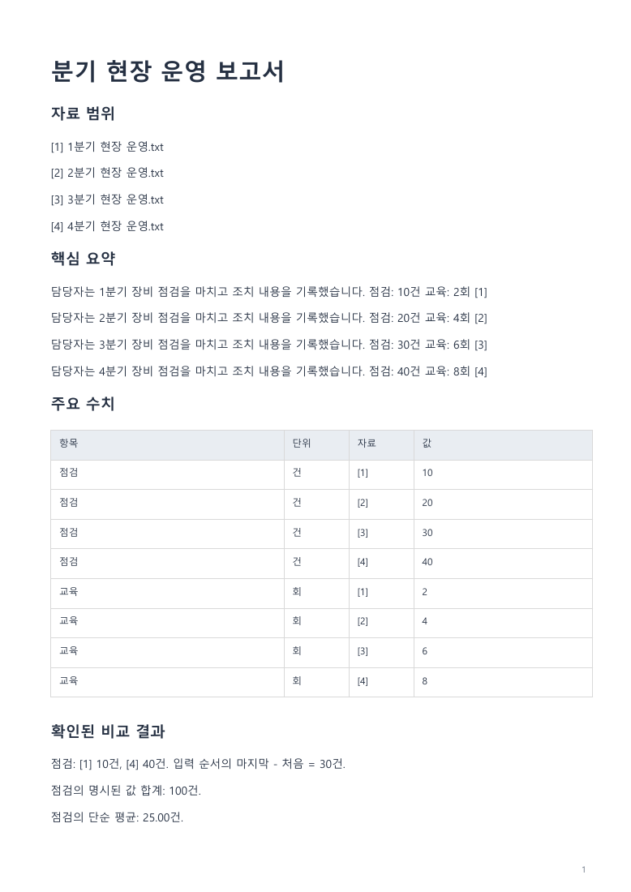
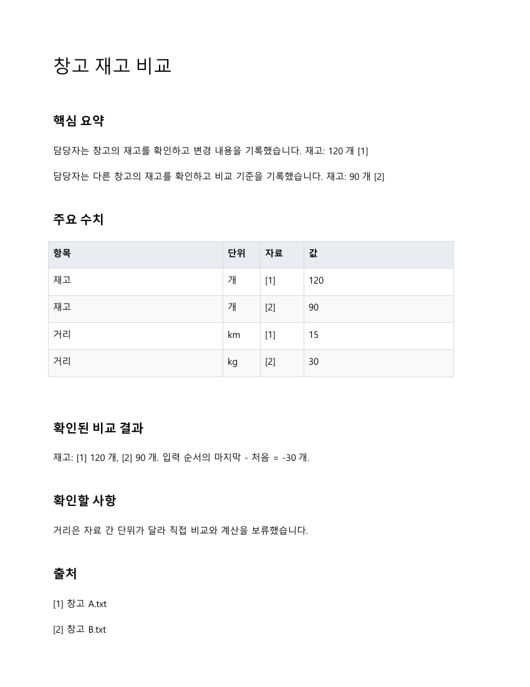
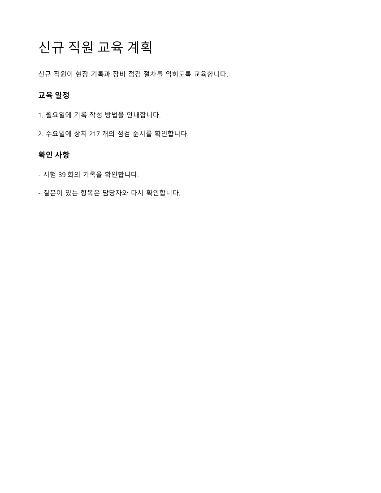
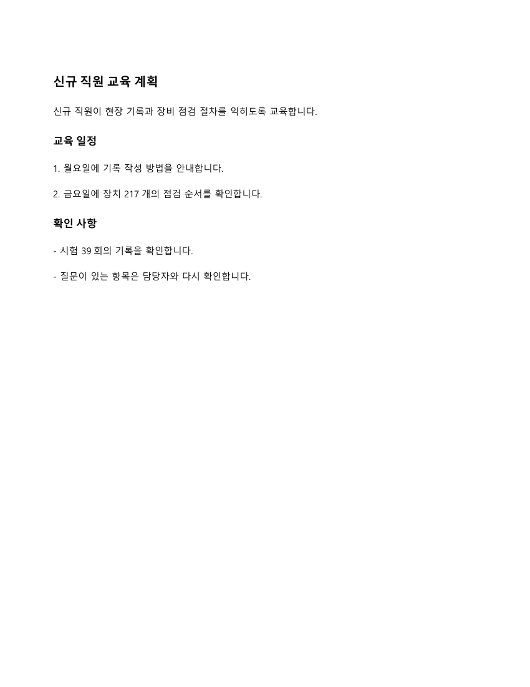

# 문서 작업 전반의 내용과 구성 개선

## 범위

보고서·요약·비교·신규 작성·지정 문구 수정·형식 변환의 공통 Python 처리기를 개선했다. PC·모바일 화면, 기기 연결, 연구 모델과 사용자 승인은 변경하지 않는다. 기존 검토·보완은 같은 격리 서비스에서 회귀 검사했다. 이 PR은 원문을 선별하고 명시된 수치를 계산하는 기능이며 새로운 내용 생성 모델의 이해 능력을 입증하는 실험이 아니다.

| 작업 | 개선한 결과 |
| --- | --- |
| 보고서 | 명시적으로 보고서·리포트 출력을 지시하면 자료 범위, 핵심 요약, 주요 내용, 수치 표, 비교 결과, 확인할 사항과 출처를 구분한다. 입력 파일명이나 인용문의 언급만으로 선택하지 않는다. |
| 요약 | 문서별 선별 예산을 줄여 보고서보다 짧게 정리한다. 완결 문장과 출처를 유지한다. |
| 비교 | 편집 가능한 수치 표를 만들고 값·단위·자료 번호를 표시한다. 표에 이미 있는 단독 수치 문단의 중복을 줄인다. |
| 신규 작성 | 제공된 내용과 명시적 Markdown 제목·문단·목록을 배치한다. 같은 제목을 두 번 출력하지 않는다. 없는 사실을 만들어 채우지 않는다. |
| 수정 | 지정된 문구의 모든 일치를 치환하고 횟수를 반환한다. 다른 내용과 수치를 임의로 요약하지 않는다. |
| 변환 | TXT·MD·자체 JSON 문서의 본문을 다시 읽을 때 제목·출처 메타데이터가 섞이지 않게 한다. 텍스트의 바깥 공백도 보존한다. |

보고서 요청은 기존 `summary`·`compare` 작업과 요청 원문을 사용한다. 작업 분류 계약을 확장하거나 모델을 교체하지 않는다. 문서 안의 제목은 요청한 제목이나 보고서 제목을 쓰며, 앱의 기본 저장 파일명 규칙은 바꾸지 않는다.

## 내용과 수치

- 숫자는 부동소수점 대신 자릿수를 제한한 Decimal 연산으로 계산한다. 쉼표와 음수를 처리한다.
- 같은 이름의 수치라도 단위가 다르거나 값이 빠지거나 한 자료에 여러 값이 있으면 계산을 보류하고 표시한다.
- 비율 합계·평균은 기준 확인이 필요하다고 표시한다. 비율 차이는 `%p`로 구별한다.
- 차이는 입력 순서의 마지막 값과 처음 값을 비교한 것임을 밝힌다. 파일 배열 순서를 시간 순서로 간주하지 않는다.
- 원문에 명시된 미해결·누락·제약·확인 필요 기록을 출처와 함께 보존한다. 자료에 없는 원인·권고·전망을 결론으로 쓰지 않는다.

## 디자인과 보존 경계

DOCX와 PDF는 제목·본문·목록·표·출처를 일반 문서의 서식으로 구분한다. Word 제목의 기존 색상 장식을 제거했다. PDF의 본문을 앱 카드처럼 꾸미지 않는다. PPT·PPTX는 흰 배경과 중립 글자색을 유지하고 표와 텍스트를 편집 가능하게 만든다. 긴 제목과 강제 줄바꿈도 내용이 잘리지 않게 나눠 배치한다.

DOCX·PDF·PPT 계열 변환은 본문 기반 재작성이다. 원래 그림·배치·전체 서식을 보존하는 변환이 아니며, 이 한계를 승인 전 미리보기와 `limitations`에 표시한다. 경고 문구는 결과 파일 본문에 섞지 않는다. Markdown의 명시적 제목과 목록을 해석하는 범위이며 임의 양식 전체를 복원하지 않는다.

## 검증

- 문서 작업 검사 28개와 기존 문서 회귀 검사 10개, 총 38개 통과. 초기 33개에 검토 의견을 재현하는 5개 검사를 추가했다.
- 검사 안에 보고서·요약·비교·작성·수정·변환의 42개 형식 조합과 TXT·MD·JSON의 9개 재변환 조합을 포함한다. 이 수를 별도의 독립 업무 수로 합산하지 않는다.
- 초기 검수에서는 가상 업무로 14개 파일을 생성했다. PDF 6개, DOCX 5개, PPTX 2개, 실제 PPT 1개이다.
- DOCX는 Word, PPT·PPTX는 PowerPoint에서 읽기 전용으로 다시 열어 예상 내용과 금지된 수정 잔여 문구를 검사했다. 발표 파일은 표 셀을 포함한 텍스트 상자의 세로 넘침도 검사했다.
- 전체 31쪽을 렌더링해 확인했다. Word·PowerPoint를 새로 시작한 검사이며 사용자 문서는 열지 않았다.
- 격리 서비스의 16개 검사 묶음에서 승인 전 실행 차단, 저장·재읽기, 다른 자바 프로세스의 모바일 프로토콜 수신, 원문 변경 시 승인 무효, 기존 검토·보완·변환을 확인했다. 실제 휴대폰이나 새 앱 UI 검증으로 계산하지 않는다.

## 검토 의견 반영 2026년 11월 8일

- PowerPoint는 본문이 없어도 각 제목을 생성한다. 단독 제목, 연속 제목, 마지막 제목, 빈 본문의 절 제목을 순서대로 보존한다. 문서 제목만 있는 경우 중복 없이 표시하고 긴 제목도 들어갈 영역을 확보한다.
- 보고서 구성은 알려진 입력 파일명과 인용 내용을 제외한 명시적인 출력 지시로 선택한다. `분기보고서.txt를 요약해줘`와 `자료의 "보고서 작성" 부분을 요약해줘`는 요약을 유지한다. `보고서로 작성해줘`, `보고서 형식으로 짧게 요약해줘`, `보고서 PDF로 만들어줘`는 보고서 구성을 선택한다.
- 단어·문형에 근거한 제한된 구분이다. 모든 자유 한국어의 의도를 이해한다고 보장하지 않는다. 기존 요청 분류와 승인 경계는 변경하지 않는다.
- 이번 수정의 가상 결과 6개를 별도로 생성했다. PPTX 3개, 실제 PPT 1개, DOCX 2개를 Word·PowerPoint에서 읽기 전용으로 재열어 제목·본문·보고서 구성과 텍스트 넘침을 확인했다. 초기 14개·31쪽 검수 기록과 구분한다. Android·PC 화면 검사와 서비스 16묶음은 이번 두 수정에서 재실행한 결과로 합산하지 않는다.

## 재현

Windows의 한글 글꼴과 Python의 reportlab·pypdf·python-docx·python-pptx가 필요하다. 검증 환경은 기존 PC 개발 묶음의 Python과 Office 라이브러리를 사용했다.

```powershell
python tests/document-work-quality.py
python tests/document-output-quality.py
python tests/document-work-fixtures.py
node scripts/check-document-work-native.mjs
```

마지막 명령은 설치된 Word·PowerPoint가 필요하다. 이미 열린 Office 세션이 있으면 중단한다. 검사용 manifest에 있는 정해진 가상 파일만 열며, 실행 파일이나 계정을 제품 설정에 등록하지 않는다. 실제 PPT 생성은 기존 PC 런타임의 네이티브 변환 도구가 있을 때 `--include-legacy-ppt`를 지정해 추가한다. 해당 도구나 실제 사용자 키를 이 PR에 복사하지 않는다.

## 통합과 남은 제한

최근 paired 실행 기반은 별도 통합 대상이다. 향후 그 제품 묶음에는 기존 파일과 함께 `document_plan.py`, `office_layout.py`도 포함해야 한다. 이번 PR만 병합해서 현재 설치본의 화면이나 저장 동작이 바뀐다고 표시하지 않는다. 실제 제품 진입점·배포 검사와 휴대폰 실기기 확인은 별도다.

수치 비교는 `항목: 값 단위`처럼 기준이 명시된 항목을 대상으로 한다. 일반 표와 자유 문장의 모든 숫자를 자동으로 같은 지표라고 해석하지 않는다. 문서 입력의 문자 인식, 복잡한 다단 편집·그림·원본 서식 보존, 독립 업무에 대한 AI 성능은 미검증이다. ZIP·APK를 만들거나 전달하는 릴리스 작업은 하지 않는다. 가상 미리보기만 공개하고 사용자 원문·계정 정보·서명 키·가중치는 포함하지 않는다.

## 가상 결과 미리보기








