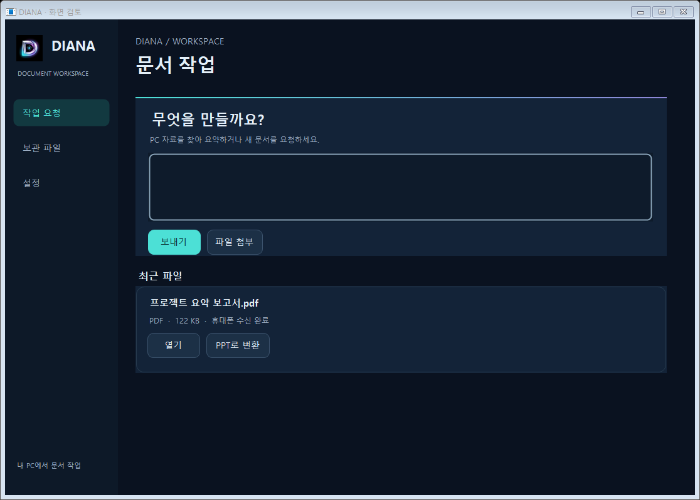
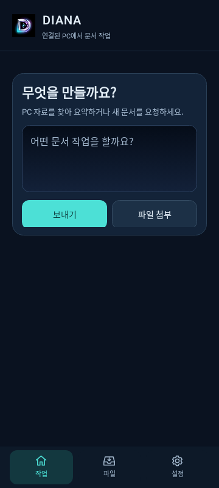
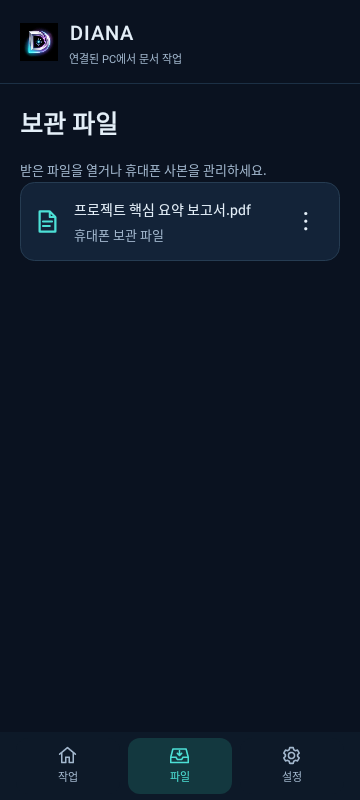
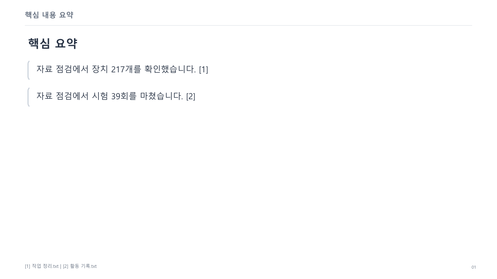

# PC·모바일 화면과 결과 문서 개선 초안

## 변경한 동작

- PC는 왼쪽 작업·파일·설정 탐색, Android는 작은 앱바와 아래 탐색으로 정리했다.
- 요청 입력, 필요한 확인, 최근 결과만 작업 화면에 표시한다. 파일과 설정은 별도 화면이다.
- Android에서 화면을 바꿔도 미전송 요청을 유지한다. 연결은 기존 6자리 코드 방식이다.
- 파일 삭제는 해당 기기의 사본만 대상으로 한다. 저장 승인을 생략하지 않는다.
- 문서당 세 줄을 뽑던 처리를 문단 복원과 완결 문장 선택으로 바꿨다. 반복되는 페이지 머리말과 공통 단어만 나열한 비교를 제거했다.
- 발표는 가로, 보고서는 세로로 배치하고 제목·본문·출처를 구분한다. 사용자 결과에는 제품 로고, 제품 머리말·꼬리말, 제품 고정 색상을 넣지 않는다. 원문 자체의 제품명은 삭제하지 않는다.
- 텍스트 미리보기에도 출처 번호와 파일 이름의 대응을 남긴다.

## 초안 PR인 이유

기본 브랜치는 PC 0.3.6·Android 0.3.9 계열이고, 검증한 격리 작업공간은 PC 0.7.8·Android 0.7.7에서 출발했다. 최근 paired 호스트·작업 엔진·실행 진입점은 아직 기본 브랜치에 없다.

이번 PR은 검토할 화면·문서 처리 소스와 독립 검사 도구를 먼저 추가한다. 기존 PC 빌드의 진입점과 Android의 기본 실행 화면은 바꾸지 않는다. Android의 새 화면은 외부에서 시작할 수 없는 별도 화면으로 등록한다. 따라서 병합만으로 사용 중인 앱 화면이 바뀌는 PR로 보고하지 않는다.

병합 전에 필요한 후속 통합은 아래와 같다.

1. 최근 paired 실행 기반 소스를 별도로 검토해 기본 브랜치와 맞추기.
2. 제품 빌드에서 PairedForm·PairedActivity·문서 엔진을 연결하고 단일 버전 원천 반영하기.
3. 같은 빌드의 최종 EXE·APK로 실제 휴대폰과 PC의 화면 및 요청부터 수신까지 확인하기.

검사 전용 BuildVersionFixture는 제품 버전이 아니며 배포물에 넣으면 안 된다. 연구 모델, 서명 키, 계정 정보와 사용자 원문은 이 PR에 포함하지 않는다. ZIP·APK는 게시하거나 전송하지 않는다.

## 검증 근거

- PDF 내용·쪽 넘김·한글·중립 머리말·메타데이터 검사 6개 통과.
- PC 네이티브 작업·승인·파일·설정 화면을 가로 1100/680 크기에서 렌더링하고 가로 넘침 검사 8개 통과. 서비스 시작과 실제 계정 요청은 차단한 상태다.
- 격리 Android 프로젝트의 기존 단위 검사 53개와 새 화면 검사 4개 통과. 새 화면 검사는 Android SDK 34의 Robolectric 네이티브 그래픽이며 실제 휴대폰 검증은 아니다.
- 격리된 PC 통합본에서 서비스 검사 16개 묶음, 시작 검사 9개, 경계·검색 위치 검사를 통과했다. 승인·저장·재읽기·수신 확인과 원본 보존을 검사했다.
- 같은 격리 통합본에서 PDF 생성과 실제 PPT 변환·PowerPoint 재열기·모바일 프로토콜 수신을 확인했다.
- 사용자 제공 PDF와 원문은 로컬에서만 읽어 배치와 문장 완결 여부를 점검했다. 해당 원문과 미리보기는 공개 PR에 넣지 않았다.

위 통합 검사는 최근 로컬 기반 위의 결과이며 기본 브랜치에서 전체 제품 통합이 완료됐다는 뜻이 아니다. 이 PR 자체에서는 아래 소스 검사부터 재현할 수 있다.

## 재현

Windows의 .NET Framework와 Node가 있는 환경:

```powershell
node scripts/check-paired-design.mjs
```

서비스를 켜거나 사용자 계정에 접근하지 않고 네이티브 컨트롤을 렌더링한다. 결과는 `.local/paired-ui-review`에 저장한다.

Python에 reportlab·pypdf가 설치된 환경:

```powershell
python tests/document-output-quality.py
```

Android SDK·Java 17·Gradle 환경:

```powershell
gradle -p android-app :app:testDebugUnitTest --tests kr.nightdesk.phone.PairedDesignTest
```

## 남은 한계

문서 처리는 원문에서 문장을 고르고 배치하는 방식이다. 자유로운 내용 이해·재서술을 하는 새 생성 모델을 넣거나 학습한 결과가 아니다. 복잡한 다단 편집·표·그림, 이미지 문자 인식, 지원 밖 파일의 판독 품질은 별도로 확인해야 한다. 앱의 원격 연결 보안 범위나 기존 문서 접근 권한을 이 변경으로 확대하지 않는다.

## 검토용 화면

아래 화면은 가상 파일 이름과 가상 본문을 사용한 렌더링이다. 실제 PC·휴대폰에서 끝까지 실행한 화면으로 해석하지 않는다.







사용자 문서에 제품 장식이 들어가지 않는 발표자료 예시:


